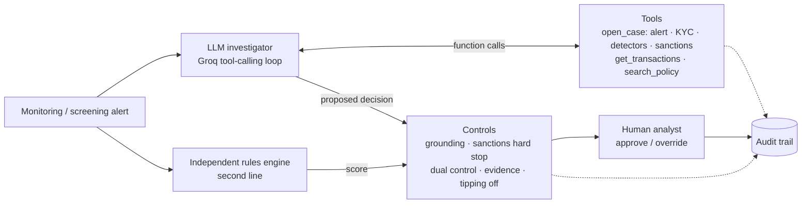

# AML Alert Triage Agent

[](https://github.com/Peerarif5656/aml-triage-agent/actions/workflows/ci.yml)


**An agentic AI investigator for bank anti-money laundering (AML) and sanctions alerts.** Given an alert, the agent
opens the case file, decides which evidence and policy it needs, and recommends **CLOSE**, **RFI** (request for
information) or **ESCALATE** with a cited case narrative. Bank-style controls check every recommendation, a human
analyst approves or overrides it, and every step is written to an audit trail.

### ▶ [Open the live app](https://aml-triage-agent-peerarif.streamlit.app)

> All data is synthetic. Customers, counterparties, the sanctions list and the higher-risk jurisdictions
> (QK, QM, QV) are fictional. The policy is illustrative and modelled on UK practice.

## Try it in 60 seconds

Open the app, keep **LLM agent (Groq)** selected, choose a case and press **Run investigation**:

| Case | Scenario | Expected outcome |
|---|---|---|
| **ALT-1005** | Student account receives money from 7 strangers and sends it to a crypto exchange within hours | **ESCALATE** (money mule) |
| **ALT-1002** | £287k credit to a nurse, explained by a documented house sale | **CLOSE** (false positive, cites `DOC-5531`) |
| **ALT-1003** | £148k payment to an entity on the sanctions list | **ESCALATE**, with the sanctions control |

Each run takes a few seconds. Open **Investigation trace** to see every tool call, control and decision.

## Why this problem

Transaction monitoring generates large alert volumes and most alerts are false positives, yet every one must be
investigated and documented by a Level 1 analyst. The work is repetitive evidence gathering (KYC file,
transactions, screening, policy) followed by a judgement and a written rationale. That suits an agent, **provided**
it is grounded, controlled, auditable and leaves the decision with a person. This project is built around those
constraints.

## What it does

- **Investigates** through a tool-calling loop on Groq (`openai/gpt-oss-120b`). The model chooses its next step: a
  clear-cut false positive can close after one tool call, a complex case pulls transactions and policy.
- **Detects typologies** with 12 deterministic detectors: structuring, money mule pass-through, round-tripping,
  dormant account reactivation, account takeover signals, PEP funds, velocity, large inflows, higher-risk
  jurisdictions, unapproved charity beneficiaries, funnel accounts and income shifts. Each finding cites
  transactions and checks for documented mitigation.
- **Screens sanctions** with fuzzy name matching (Jaro-Winkler on normalised tokens) plus date of birth,
  nationality and country, separating potential true matches from false positives.
- **Retrieves policy** (BM25 RAG over the policy) so every decision cites the relevant `POL-...` sections.
- **Applies controls** before anyone sees the recommendation: grounding, sanctions hard stop, independent dual
  control, evidence checks, tipping-off flag, case scoping and automatic fallback.
- **Keeps a human in the loop**: approve or override (with a reason), edit the narrative, download the case report
  and the full audit trail.
- **Is evaluated** against analyst-labelled alerts, with escalation recall and grounding as headline metrics.

## Architecture



The model receives the alert ID and a versioned system prompt, calls tools, reads the results and continues until it
returns a JSON decision. The decision is validated, checked by the controls alongside the rules engine's independent
score, and shown to the analyst.

### Tools

| Tool | Returns |
|---|---|
| `open_case` | The case file in one call: alert, KYC profile, detector findings and sanctions screening |
| `get_transactions` | Filtered transactions up to the alert date (days, direction, minimum amount), with a summary |
| `search_policy` | The most relevant policy sections with their `POL-...` IDs |

Every tool is **scoped to the customer on the alert**, so the model cannot read other customers' data. Granular
tools (`get_alert`, `get_customer_profile`, `detect_typologies`, `screen_sanctions`) are also available
(`TriageAgent(..., toolset="granular")`) for models that call several tools per turn.

### Controls

| Control | Purpose |
|---|---|
| `CTRL-SCHEMA` | Unparseable output is repaired once, then the case falls back to the rules investigator |
| `CTRL-GROUNDING` | Every cited ID (`TX-`, `SAN-`, `DOC-`, `POL-`) must have been returned by a tool in this case; invented IDs are removed and flagged |
| `CTRL-SANCTIONS` | A potential true sanctions match can never be closed or sent for RFI by the agent |
| `CTRL-DUAL` | Disagreement with the independent rules engine routes the case to a senior analyst |
| `CTRL-EVIDENCE` | Escalations need cited evidence; closures need cited mitigation when the risk score is elevated |
| `CTRL-TIPOFF` | An escalation that suggests contacting the customer is flagged for MLRO approval (POCA s.333A) |
| `CTRL-HITL` | Nothing is actioned automatically; overrides require a reason |
| `CTRL-FALLBACK` | If the model is unavailable or rate limited, the rules investigator completes the case and says so |

## Results

<!-- RESULTS -->
Evaluated on 13 analyst-labelled alerts (`python -m eval.run_eval`, or the app's **Evaluation** tab):

| Investigator | Accuracy | Escalation recall | Missed escalations | Grounding |
|---|---|---|---|---|
| Offline rules engine | 13/13 | 100% | 0 | 100% |

The rules engine was calibrated on this synthetic set, so its score is a sanity check rather than evidence of
generalisation.
<!-- /RESULTS -->

**Engineering for cost and latency.** The first version used seven small tools; gpt-oss calls one tool per turn and
each turn re-sends the conversation, so a case took about 24,000 tokens and 140 seconds on Groq's free tier. Bundling
the case file into `open_case`, using low reasoning effort and Groq prompt caching brought a typical case to about
6,000 tokens and 2–3 seconds with the same decisions.

## UK regulatory alignment

The design maps to the obligations a UK bank's financial crime and model risk functions apply. Full mapping and
limitations in **[docs/GOVERNANCE.md](docs/GOVERNANCE.md)**.

| Area | Reference | In this project |
|---|---|---|
| Suspicious activity and tipping off | POCA 2002 ss.330, 333A, 335 | Escalation narratives for the MLRO; `CTRL-TIPOFF`; DAML in policy |
| CDD, EDD, PEPs, record keeping | MLR 2017 regs 28, 33, 35, 40 | KYC evidence, EDD recency, PEP detector, append-only audit trail |
| Financial sanctions | SAMLA 2018, OFSI | Screening with secondary identifiers; potential true matches held and escalated |
| Model risk management | PRA SS1/23 | Versioned prompts and data, independent validation, dual control, monitoring hooks |
| Data protection | UK GDPR Arts 5(1)(c), 22 | Case-scoped tools; a person makes every decision |

## Dataset

13 alerts across 13 synthetic customers (708 transactions over six months), each with a senior-analyst label:

| Alert | Scenario | Label |
|---|---|---|
| ALT-1001 | Cash deposits of £9.2k–£9.9k at five branches, then a £56k payment | ESCALATE |
| ALT-1002 | £287k from solicitors, matching a documented house sale | CLOSE |
| ALT-1003 | Payment to an entity on the sanctions list (true match) | ESCALATE |
| ALT-1004 | Customer name similar to a listed person; DOB and nationality differ | CLOSE |
| ALT-1005 | Student account: 7 unrelated payers, funds out to crypto within hours | ESCALATE |
| ALT-1006 | Payments to a higher-risk jurisdiction supplier verified in EDD | CLOSE |
| ALT-1007 | Café turnover up about 4x with no explanation on file | RFI |
| ALT-1008 | PEP receives £95k "advisory services" from an offshore company | ESCALATE |
| ALT-1009 | Round amounts sent to a related company and returned within days | ESCALATE |
| ALT-1010 | Dormant account reactivated after contact details changed | ESCALATE |
| ALT-1011 | Salary jump, explained by a verified new job | CLOSE |
| ALT-1012 | Charity pays £12k to an individual not on the approved list | RFI |
| ALT-1013 | New business receiving 34 small payments from individuals | RFI |

The dataset is generated deterministically by `scripts/generate_data.py`.

## Run locally

```bash
python -m venv .venv && source .venv/bin/activate   # Windows: .venv\Scripts\activate
pip install -r requirements-dev.txt
pytest                                               # 74 tests, no API key needed
python -m eval.run_eval                              # offline evaluation
streamlit run app.py
```

The app works without a key using the offline rules engine. For the LLM agent, get a free key at
[console.groq.com](https://console.groq.com/keys) and paste it in the sidebar, or copy
`.streamlit/secrets.toml.example` to `.streamlit/secrets.toml`. LLM evaluation from the command line:
`GROQ_API_KEY=... python -m eval.run_eval --mode llm`.

To deploy your own copy on Streamlit Community Cloud: create an app from this repository with main file `app.py` and
Python 3.12, and add `GROQ_API_KEY` under **Secrets**.

## Project structure

```
aml_agent/
  agent.py        investigation loop (LLM and rules investigators), analyst decision
  tools.py        tool implementations, JSON schemas for function calling, case scoping
  typologies.py   12 deterministic AML detectors with mitigation checks
  screening.py    sanctions screening: normalisation, Jaro-Winkler, secondary identifiers
  retrieval.py    BM25 policy retrieval (RAG)
  rules.py        independent rules engine (scores, thresholds)
  controls.py     guardrails applied before a human sees a recommendation
  llm.py          Groq client (OpenAI-compatible): retries, model fallback, rate-limit reporting
  prompts.py      versioned system prompts
  narrative.py    decision builder for the rules investigator
  audit.py        append-only audit trail
  report.py       Markdown case report
app.py            Streamlit UI
data/             synthetic customers, transactions, alerts, sanctions list, labels, policy
eval/             evaluation harness and saved results
tests/            74 unit tests, including a scripted mock LLM for the agent loop and controls
docs/             walkthrough, design FAQ, governance and regulatory mapping
demo/             self-contained web version of the demo (built by scripts/build_demo.py)
scripts/          dataset generator and web demo builder
```

## Design decisions

- **Deterministic detection, LLM judgement.** Pattern detection and sanctions matching are code, so they are
  testable and explainable. The LLM weighs mixed evidence and drafts the case.
- **Independent second line.** The rules engine never sees the LLM's answer and the LLM never sees the rules score,
  so disagreement is a real signal.
- **Grounding over trust.** The model can only cite identifiers that a tool returned in the same case.
- **Fail safe.** Rate limits, outages, retired models and bad output all degrade gracefully, and the trace says so.
- **Provider-neutral.** The agent depends on a small response type; any OpenAI-compatible endpoint works.

More in **[docs/WALKTHROUGH.md](docs/WALKTHROUGH.md)** (walkthrough and design FAQ).

## Limitations

- Synthetic data and a small labelled set; a real deployment needs back-testing on historical alert outcomes.
- Grounding checks that a cited ID exists in the case, not yet that it supports the specific sentence.
- Payment references reach the model, so production would add prompt-injection defences and red-teaming.
- BM25 over one illustrative policy; production would use hybrid retrieval over the full policy library.

## Author

**Peer Arif** · AI engineer focused on LLM agents, retrieval-augmented generation and evaluation · MSc Artificial
Intelligence and Data Analytics (Distinction), Loughborough University London · [GitHub](https://github.com/Peerarif5656)
