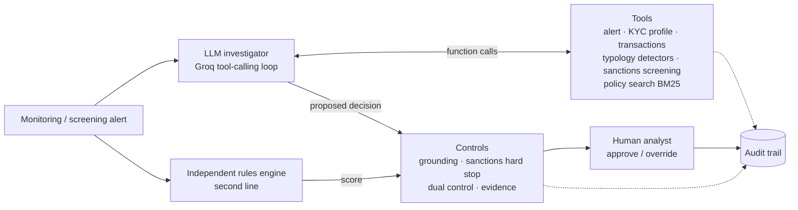

# AML Alert Triage Agent

[](https://github.com/Peerarif5656/aml-triage-agent/actions/workflows/ci.yml)

An agentic AI investigator for bank **anti-money laundering (AML) transaction monitoring and sanctions alerts**.
Given an alert, the agent gathers evidence with tools, screens for sanctions, checks the bank's policy, and
recommends **CLOSE**, **RFI** (request for information) or **ESCALATE**, with a cited narrative. Guardrails check
every recommendation, a human analyst approves or overrides it, and every step is written to an audit trail.

**Live app:** [aml-triage-agent-peerarif.streamlit.app](https://aml-triage-agent-peerarif.streamlit.app) · **Web demo:** [`demo/index.html`](demo/index.html) · **Built by:** [Peer Arif](https://github.com/Peerarif5656)

> All data is synthetic. Customers, counterparties, the sanctions list and the higher-risk jurisdictions
> (QK, QM, QV) are fictional. The policy is illustrative and modelled loosely on UK practice.

---

## Why this problem

Banks generate large volumes of transaction monitoring alerts and most turn out to be false positives, yet each
one must be investigated and documented by a Level 1 analyst. The work is repetitive evidence gathering
(KYC file, transactions, screening, policy) followed by a judgement and a written rationale. That is a good fit
for an agent, **provided** it is grounded, controlled, auditable and keeps a human in charge of the decision.
This project is built around those constraints.

## What it does

- **Investigates** an alert through a tool-calling loop on Groq (`openai/gpt-oss-120b` by default; the app lists only
  models your Groq account can use and switches automatically if a model is retired).
- **Detects typologies** with 12 deterministic detectors: structuring, money mule pass-through, round-tripping,
  dormant account reactivation, account takeover signals, PEP funds, velocity, large inflows, higher-risk
  jurisdictions, unapproved beneficiaries, funnel accounts and income shifts. Each finding cites transactions
  and checks for documented mitigation.
- **Screens sanctions** with fuzzy name matching (Jaro-Winkler on normalised tokens) and secondary
  identifiers (DOB, nationality, country) to separate true matches from false positives.
- **Retrieves policy** (RAG over the policy document with BM25) so decisions cite the right sections.
- **Applies controls**: grounding check on every cited ID, sanctions hard stop, dual control against an
  independent rules engine, evidence checks, case scoping and automatic fallback.
- **Keeps a human in the loop**: the analyst approves or overrides (overrides need a reason) and can edit the
  narrative. Case report and full audit trail are downloadable.
- **Is evaluated** against analyst-labelled alerts, with escalation recall and grounding as headline metrics.

## Architecture



**The loop.** The model gets the alert ID and a versioned system prompt. It calls tools (in parallel where
they are independent), reads the results and keeps going until it returns a JSON decision. The decision is
validated, then passed through the controls with the rules engine's independent score, then shown to the analyst.

### Tools

| Tool | Returns |
|---|---|
| `get_alert` | Rule triggered, date, summary, triggering transaction IDs |
| `get_customer_profile` | KYC data, expected activity, PEP status, EDD date, known counterparties, expected events, documents |
| `get_transactions` | Filtered transactions up to the alert date, with a summary |
| `detect_typologies` | Findings from the 12 detectors with evidence and mitigation |
| `screen_sanctions` | Hits for the customer and all counterparties, with strength STRONG / POSSIBLE / WEAK |
| `search_policy` | The most relevant policy sections with their `POL-...` IDs |

All tools are **scoped to the customer on the alert**: the model cannot browse other customers' data.

### Controls

| Control | Purpose |
|---|---|
| `CTRL-SCHEMA` | Unparseable output is repaired once, then the case falls back to the rules investigator |
| `CTRL-GROUNDING` | Every cited ID (`TX-`, `SAN-`, `DOC-`, `POL-`) must have been returned by a tool in this case; invented IDs are removed and flagged |
| `CTRL-SANCTIONS` | A potential true sanctions match can never be closed or sent for RFI by the agent |
| `CTRL-DUAL` | LLM vs rules engine disagreement routes the case to a senior analyst |
| `CTRL-EVIDENCE` | Escalations need evidence; closures need cited mitigation when the risk score is elevated |
| `CTRL-HITL` | Nothing is actioned automatically; overrides require a reason |
| `CTRL-FALLBACK` | If the LLM is unavailable or rate limited, the rules investigator completes the case and says so |

## Dataset

13 alerts across 13 synthetic customers (708 transactions over six months), each with a senior-analyst label:

| Alert | Scenario | Label |
|---|---|---|
| ALT-1001 | Cash deposits of £9.2k-£9.9k at five branches, then a £56k payment | ESCALATE |
| ALT-1002 | £287k from solicitors, matching a documented house sale | CLOSE |
| ALT-1003 | Payment to an entity on the sanctions list (true match) | ESCALATE |
| ALT-1004 | Customer name similar to a listed person, DOB and nationality differ | CLOSE |
| ALT-1005 | Student account: 7 unrelated payers, funds out to crypto within hours | ESCALATE |
| ALT-1006 | Payments to a higher-risk jurisdiction supplier verified in EDD | CLOSE |
| ALT-1007 | Café turnover up about 4x with no explanation on file | RFI |
| ALT-1008 | PEP receives £95k "advisory services" from an offshore company | ESCALATE |
| ALT-1009 | Round amounts sent to a related company and returned within days | ESCALATE |
| ALT-1010 | Dormant account reactivated after contact details changed | ESCALATE |
| ALT-1011 | Salary jump, explained by a verified new job | CLOSE |
| ALT-1012 | Charity pays £12k to an individual not on the approved list | RFI |
| ALT-1013 | New business receiving 34 small payments from individuals | RFI |

The dataset is generated deterministically by `scripts/generate_data.py`.

## Evaluation

```bash
python -m eval.run_eval                          # offline rules investigator
GROQ_API_KEY=... python -m eval.run_eval --mode llm --sleep 30   # LLM agent
```

Reports are written to `eval/results/`. Headline metrics: accuracy, **escalation recall** (missing a
suspicious case is the costliest error in AML), missed escalations, **grounding rate**, and how often the
controls intervened. The rules engine scores 13/13 with 100% grounding; it was calibrated on this dataset, so treat
that as a sanity check. The informative result is the LLM agent against the same labels, which you can run
from the command line or the app's Evaluation tab.

## Run locally

```bash
python -m venv .venv && source .venv/bin/activate   # Windows: .venv\Scripts\activate
pip install -r requirements-dev.txt
pytest                                               # 68 tests, no API key needed
streamlit run app.py
```

The app works without a key using the offline rules engine. For the LLM agent, get a free key at
[console.groq.com](https://console.groq.com/keys) and either paste it in the sidebar or copy
`.streamlit/secrets.toml.example` to `.streamlit/secrets.toml`.

## Deploy to Streamlit Community Cloud (free)

1. Push this folder to a new **public** GitHub repository.
2. Go to [share.streamlit.io](https://share.streamlit.io), sign in with GitHub, click **Create app**.
3. Choose the repository, branch `main`, main file `app.py`. Under **Advanced settings**, pick Python 3.12.
4. In **Secrets**, add `GROQ_API_KEY = "gsk_..."`.
5. Deploy, then put the app URL at the top of this README.

## Web demo (no backend)

`demo/index.html` is a single self-contained page that runs the same investigation in the browser: the
offline investigator works anywhere (open the file, or host it on GitHub Pages or Netlify), and when the page is
opened as a Claude artifact it can also run a live tool-calling investigation on Claude using the page's own
functions as tools. `python scripts/build_demo.py --repo-url https://github.com/Peerarif5656/aml-triage-agent` rebuilds it
from `demo/template.html`, embedding the dataset and the Python engine's outputs so both front ends agree.

## Project structure

```
aml_agent/
  agent.py        investigation loop (LLM and rules investigators), analyst decision
  tools.py        tool implementations + JSON schemas for function calling, case scoping
  typologies.py   12 deterministic AML detectors with mitigation checks
  screening.py    sanctions screening: normalisation, Jaro-Winkler, secondary identifiers
  retrieval.py    BM25 policy retrieval (RAG)
  rules.py        independent rules engine (scores, thresholds)
  controls.py     guardrails applied before a human sees a recommendation
  llm.py          Groq client (OpenAI-compatible), retries, JSON extraction
  prompts.py      versioned system prompt
  narrative.py    decision builder for the rules investigator
  audit.py        append-only audit trail
  report.py       Markdown case report
data/             synthetic customers, transactions, alerts, sanctions list, labels, policy
eval/run_eval.py  evaluation harness
tests/            68 unit tests incl. a scripted mock LLM for the agent loop and controls
app.py            Streamlit UI
demo/             self-contained web demo (template + built page)
scripts/          dataset generator and web demo builder
docs/             demo script and interview notes
```

## Design decisions

- **Deterministic detectors, LLM judgement.** Pattern detection and sanctions matching are code, so they are
  testable and explainable. The LLM does what code does badly: weighing mixed evidence and writing the case.
- **Second line by design.** The rules engine never sees the LLM's output and the LLM never sees the rules score,
  so disagreement is a real signal rather than an echo.
- **Grounding over trust.** The model can only cite identifiers that a tool returned in the same case.
- **Fail safe.** Rate limits, outages and bad output all degrade to the rules investigator with a visible flag.
- **Provider-neutral.** The agent depends on a small `LLMResponse` type; any OpenAI-compatible endpoint works.

## Limitations and next steps

- Synthetic data and a small labelled set; a real deployment needs historical alert outcomes and back-testing.
- BM25 retrieval over one document; production would use hybrid retrieval over the full policy library.
- Next: integrate with a case management system, add PII redaction before LLM calls, red-team prompts
  (prompt injection via transaction references), drift monitoring, and model risk documentation.
